# LAB 1B: PC System Fundamentals, Disk Sectors and Partition Analysis

**Full name:** Banjo Ayodele Oreoluwa  
**Registration number:** C11/26/FCDF/17169  
**Course code:** CIP-B101  
**Date:** 6 November 2026  
**Platform used:** Windows 11 PC  
## Introduction

This lab examines basic computer information and evidence found in Windows.

I checked the system specifications, storage devices and partitions.

I observed running processes and their process IDs and thread counts.

I calculated disk and partition sizes using sector information.

I also examined the boot process and file systems used on the PC.

These tasks show how computer records can help in digital forensic investigations.

## Tools Used

Windows 11 Pro; System Information (msinfo32); Command Prompt (systeminfo, tasklist and DiskPart listing commands); PowerShell (Get-Disk, Get-Partition, Get-Volume and Get-Process); Disk Management.

## Part A — System Identification And Evidence Layer Mapping

### A1. Capture basic system specification

| Field | Observed value | Evidence |
| --- | --- | --- |
| Operating system | Microsoft Windows 11 Pro; version 10.0.26200 (build 26200) | Figures 1, 3 |
| Computer manufacturer/model | HP EliteBook 820 G3 | Figures 1, 3 |
| System architecture | x64-based PC | Figures 1, 3 |
| Processor | Intel Core i7-6600U @ 2.60 GHz; 2 cores, 4 logical processors (as displayed in System Information) | Figure 1 |
| Installed physical RAM | 16.0 GB (System Information); 16,265 MB total physical memory (systeminfo) | Figures 2, 3 |
| Firmware boot mode | UEFI | Figure 1 |
| Secure Boot state | On | Figure 1 |
| BIOS version/date | HP N75 Ver. 01.57, 28 July 2022 | Figures 1, 3 |

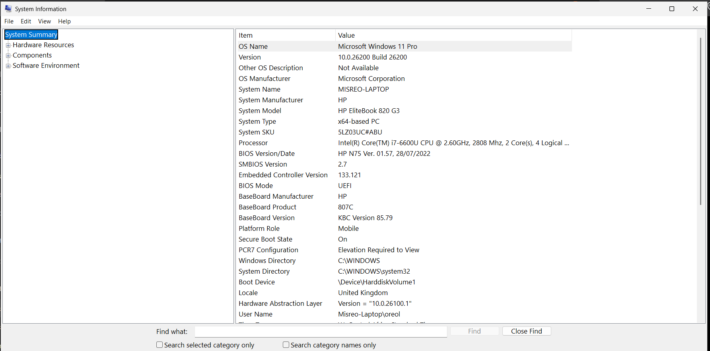
*Figure 1. System Information: OS, computer model, processor, UEFI boot mode and Secure Boot state.*

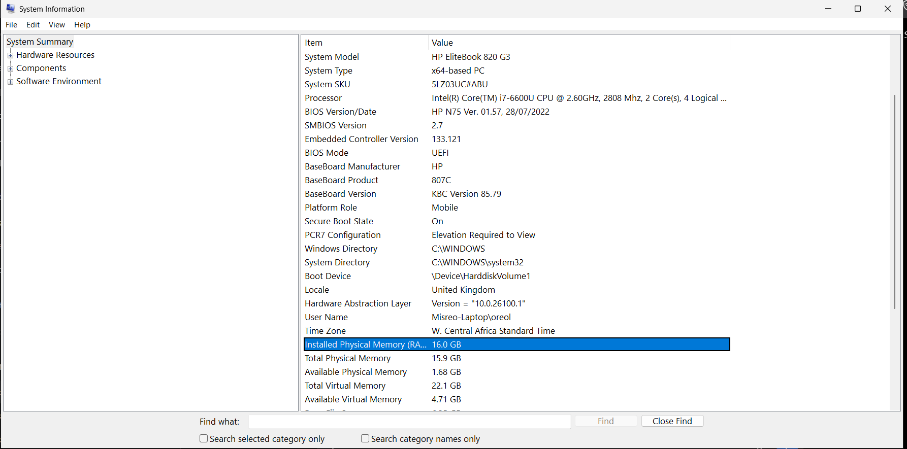
*Figure 2. System Information: installed and available physical memory.*

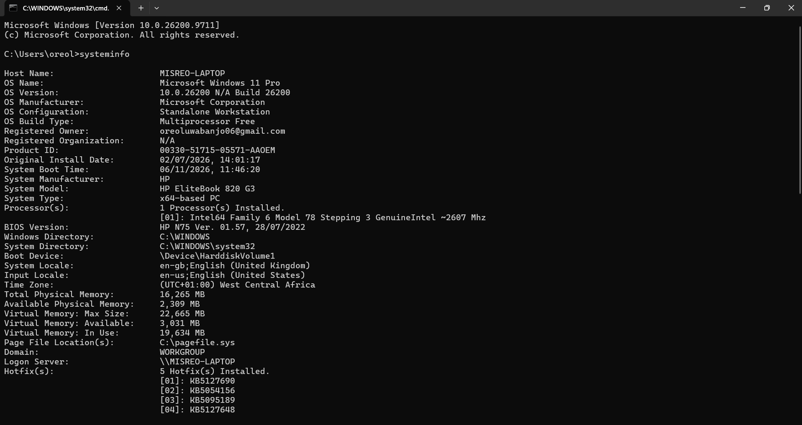
*Figure 3. Command Prompt: systeminfo output confirming OS and computer specifications.*

### A2. Capture storage information

| Disk property | Observed value |
| --- | --- |
| Disk number | 0 |
| Model | INTEL SSDSCKKF256G8H |
| Disk capacity | 256,060,514,304 bytes (256.060514304 decimal GB; approximately 238.47 GiB) |
| Partition style | GPT |
| Logical sector size | 512 bytes |
| Physical sector size | 512 bytes |

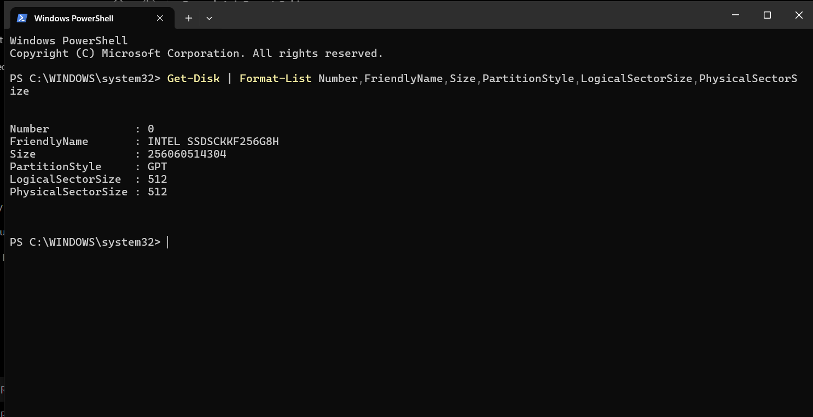
*Figure 4. Get-Disk output showing model, capacity, GPT and sector sizes.*

| No. | Type | Offset (bytes) | Size (bytes) |
| --- | --- | --- | --- |
| 1 | System | 1,048,576 | 209,715,200 |
| 2 | Reserved | 210,763,776 | 16,777,216 |
| 3 | Basic (C:) | 227,540,992 | 254,868,979,712 |
| 4 | Recovery | 255,096,520,704 | 962,592,768 |

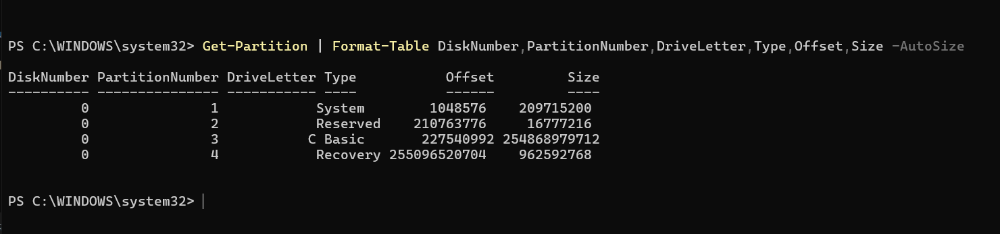
*Figure 5. Get-Partition output listing Disk 0 partition numbers, types, offsets and sizes.*

| Volume | File system | Volume size (bytes) | Free space (bytes) |
| --- | --- | --- | --- |
| C: | NTFS | 254,868,975,616 | 75,482,394,624 |
| No drive letter | NTFS | 962,588,672 | 120,283,136 |

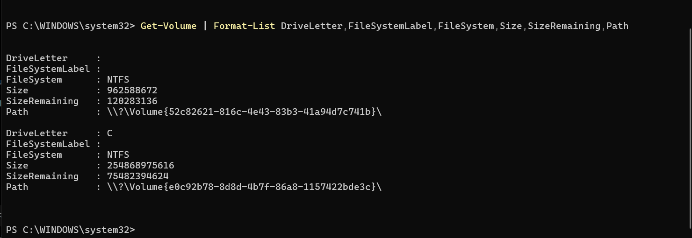
*Figure 6. Get-Volume output showing NTFS file systems, volume sizes and remaining space.*

### A3. Map evidence sources to system layers

| Layer / source | Example evidence | Where it may be found | Forensic importance |
| --- | --- | --- | --- |
| User layer | Opened files, search terms, account activity | Recent-file lists, browser history, user profile | Associates actions with a user context; attribution requires corroboration |
| Application layer | Document metadata, browser cache, application logs | Application databases, profile folders, logs | Identifies software use and potential activity traces |
| Operating system layer | Event records, installed software, user accounts | Windows Event Logs, Registry, system directories | Helps reconstruct system events and account activity |
| Disk / file-system layer | Files, deleted entries, metadata, partitions | NTFS metadata, allocated and unallocated disk space | Supports file recovery, provenance and timeline analysis |
| Memory / process layer | Active processes, PIDs, transient data | Live process listings and authorized RAM acquisition | Can reveal volatile execution state not preserved on disk |

Evidence may appear in more than one layer because one action can create records in applications, Windows and the file system.

The HP EliteBook 820 G3 runs Windows 11 Pro with 16 GB RAM, UEFI and Secure Boot. Its Intel SSD uses GPT and contains four partitions. Two NTFS volumes were reported.

## Part B — Program, Process And Thread Investigation

### B1. Observe running processes

| Process name | PID | Likely purpose |
| --- | --- | --- |
| smss.exe | 560 | Windows Session Manager; helps set up system sessions. |
| winlogon.exe | 924 | Windows logon process; supports sign-in and sign-out. |
| services.exe | 996 | Service Control Manager; manages Windows services. |

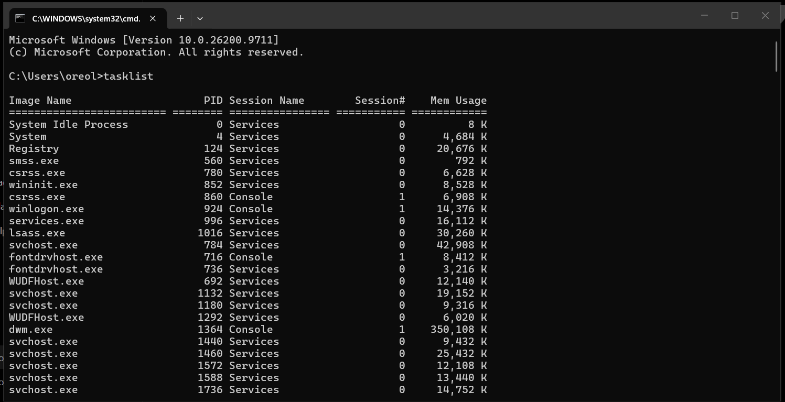
*Figure 7. Command Prompt tasklist output showing running process names, PIDs and memory usage.*

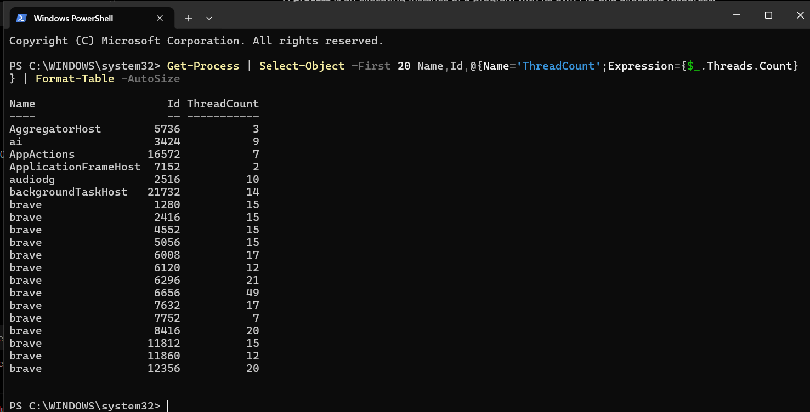
*Figure 8. PowerShell Get-Process output showing process IDs and thread counts.*

### B2. Explain the difference

A program is software stored on a computer. A process is a running program with its own PID. A thread is a unit of work within a process. A process can have several threads.

The Brave browser has several running processes in Figure 8. Each process has its own PID and thread count.

Process names, PIDs and thread counts help investigators identify running software and check for unusual activity during malware investigations.

The screenshots identify running processes, their PIDs and thread counts.

## Part C — Disk Sector And Disk Size Calculation

### C1. Reproduce the slide calculation

Given: 400 sectors per track, 12 heads, 17,000 cylinders and 512 bytes per sector.

| Item | Calculation | Result |
| --- | --- | --- |
| Total sectors | 400 × 12 × 17,000 | 81,600,000 sectors |
| Total bytes | 81,600,000 × 512 | 41,779,200,000 bytes |
| Kilobytes | 41,779,200,000 ÷ 1,024 | 40,800,000 KB |
| Megabytes | 40,800,000 ÷ 1,024 | 39,843.75 MB |
| Gigabytes | 39,843.75 ÷ 1,024 | 38.91 GiB (rounded) |

### C2. Calculate the sizes of partitions 1 and 2

Disk 0 has 512 bytes per logical sector. The partition details below come from the read-only PowerShell output.

| Partition / type | Start sector | Sector count | Bytes/sector | File system |
| --- | --- | --- | --- | --- |
| 1 — System | 2,048 | 409,600 | 512 | Not shown |
| 2 — Reserved | 411,648 | 32,768 | 512 | Not applicable (MSR) |

Formula: Partition size = sector count × bytes per sector. Size in GiB = bytes ÷ 1,024 ÷ 1,024 ÷ 1,024.

Partition 1: 409,600 × 512 = 209,715,200 bytes.
209,715,200 ÷ 1,024 ÷ 1,024 ÷ 1,024 = 0.1953125 GiB (200 MiB).

Partition 2: 32,768 × 512 = 16,777,216 bytes.
16,777,216 ÷ 1,024 ÷ 1,024 ÷ 1,024 = 0.015625 GiB (16 MiB).

Sector check: Partition 1 starts at 2,048 and ends at 411,647. Partition 2 starts at 411,648 and ends at 444,415. These values match the PowerShell output.

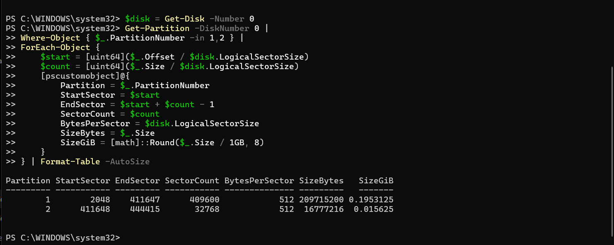
*Figure 9. Read-only PowerShell output showing the start sector, end sector, sector count and calculated sizes for partitions 1 and 2.*

## Part D — Safe Partition Table Inspection

### D1. Windows method

Disk Management shows Disk 0 as an online 238.46 GB disk, with an EFI System partition, C: partition and Recovery partition. The Microsoft Reserved partition is shown in the PowerShell and DiskPart listings.

| Disk | Partition | Type | Size (DiskPart) |
| --- | --- | --- | --- |
| 0 | 1 | System | 200 MB |
| 0 | 2 | Reserved | 16 MB |
| 0 | 3 | Primary | 237 GB |
| 0 | 4 | Recovery | 918 MB |

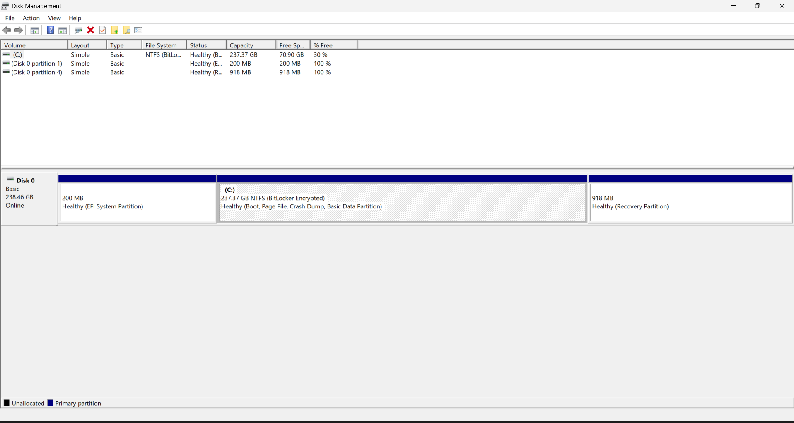
*Figure 10. Disk Management showing Disk 0 and its visible partitions.*

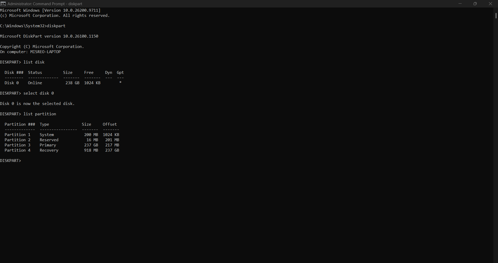
*Figure 11. DiskPart read-only list disk and list partition output.*

## Part E — Mbr, Gpt And Boot Process Explanation

### E1. Explain the boot process

1. Power-on and POST: When the PC is switched on, it receives power and the firmware runs the Power-On Self-Test (POST). This checks basic hardware, including the memory and processor, before booting continues.

2. BIOS/UEFI and firmware settings: The firmware reads saved settings, such as the boot order, and selects a device to start from. Older BIOS systems use CMOS-backed settings; this PC uses UEFI firmware.

3. MBR/GPT and EFI boot records: On older BIOS systems, boot code in the MBR starts the boot process. On this UEFI/GPT system, a firmware boot entry points to Windows Boot Manager on the EFI System Partition.

4. Boot manager and loader: Windows Boot Manager selects the Windows installation and starts the Windows OS loader. The loader prepares the files needed to start Windows.

5. Kernel loading: The loader brings the Windows kernel and essential drivers into memory. The kernel then takes control of the system's main operations.

6. Operating system control: Windows starts system services and the sign-in process. Once signed in, the user can run programs and access files.

Forensic relevance: Firmware settings and boot entries can show how the PC is set to start. Boot files and Windows logs may provide evidence about startup activity.

My system uses UEFI, not Legacy BIOS. This is shown in the System Information screenshot in Part A. The disk uses GPT, as shown by the Get-Disk output in Part A.

### E2. Compare MBR and GPT

| Feature | MBR | GPT |
| --- | --- | --- |
| Age / design | Older partitioning scheme. | Newer partitioning scheme commonly used with UEFI. |
| Size limitation | Typically supports disks up to 2 TiB with 512-byte sectors. | Supports much larger disks. |
| Partition information | Partition entries are stored in the first sector alongside boot code. | Uses a primary and backup GPT header and partition-entry array. |
| Forensic issue | Damage to sector 0 can affect partition interpretation. | Backup GPT structures may help check or recover partition information. |

## Part F — File System Identification And Interpretation

The Get-Volume results in Part A show two NTFS volumes:

| Volume / partition | File system | Size |
| --- | --- | --- |
| C: (Partition 3) | NTFS | 237.37 GB |
| Recovery (Partition 4) | NTFS | 918 MB |

Screenshot evidence: The Get-Volume screenshot in Part A shows the file systems. The Get-Partition screenshot identifies the partition numbers.

A file system organises files and stores details such as file names, locations and timestamps. This matters in digital forensics because investigators can use these details to find files and examine when activity happened. NTFS records file information in the Master File Table (MFT).

## Part G — Final Practical Assignment

Partition table evidence: Disk 0 uses GPT. The Get-Partition output in Part A, the sector calculation screenshot in Part C (Figure 9), and the DiskPart partition listing in Part D (Figure 11) provide the values used below.

### Partition 1 — EFI System Partition

1. Identify: Disk 0, partition 1, System (EFI), shown as 200 MB in DiskPart and Disk Management (Figures 10–11).

2. Verify sectors: Start sector = 2,048; end sector = 411,647 (Figure 9).

3. Sector count = 411,647 − 2,048 + 1 = 409,600 sectors.

4. Size = 409,600 × 512 bytes = 209,715,200 bytes.

5. Size in GiB = 209,715,200 ÷ 1,073,741,824 = 0.1953125 GiB.

### Partition 2 — Microsoft Reserved Partition

1. Identify: Disk 0, partition 2, Reserved (MSR), shown as 16 MB in DiskPart (Figure 11).

2. Verify sectors: Start sector = 411,648; end sector = 444,415 (Figure 9).

3. Sector count = 444,415 − 411,648 + 1 = 32,768 sectors.

4. Size = 32,768 × 512 bytes = 16,777,216 bytes.

5. Size in GiB = 16,777,216 ÷ 1,073,741,824 = 0.015625 GiB.

### Comparison with Windows-reported sizes

| Partition | Calculated size | Windows-reported size |
| --- | --- | --- |
| 1 — EFI System | 0.1953125 GiB (200 MiB) | 200 MB |
| 2 — MSR | 0.015625 GiB (16 MiB) | 16 MB |

The displayed sizes agree after unit conversion. Windows labels these sizes as MB, while the sector calculations give 200 MiB and 16 MiB. The smaller GiB values are due to converting to a larger unit, not missing partition space.

## Conclusion

In this lab, I identified my PC specifications, checked running processes and inspected disk partitions using Windows tools. I calculated the sizes of partitions 1 and 2 from their sector counts and confirmed that the system uses UEFI, GPT and NTFS volumes. I learned that system details, process records, partition information and file system metadata can help investigators understand computer activity.
